# 팀원용 프로젝트 설명: 3D 점군에서 먼저 검토할 오분류 찾기

작성 기준: **2026-11-26(KST), 전체 75조건 실험과 독립 검증을 완료한 최종 결과**. 이정연은 구현·실행·검증·해석을, 이현택은 PPT 제작과 12/3 발표를 맡는다. 발표는 10분, 질의응답은 3분이다.

이 문서는 코드를 읽지 않아도 프로젝트를 이해하고 발표 자료를 구성할 수 있도록 작성했다. 처음에는 각 절 맨 위의 **5줄 요약**을 읽고, 이후 방법과 실험의 상세 설명을 보면 된다. 그림은 본문에 직접 삽입했으며, 파일을 누르면 원본을 열 수 있다. MD 파일을 따로 옮길 때는 `results/figures/` 폴더도 함께 옮겨야 그림이 보인다. 전달 ZIP에는 필요한 그림과 표가 포함된다.

- [1. Introduction — 왜 이 문제를 선택했는가](#1-introduction--왜-이-문제를-선택했는가)
- [2. Method — 어떻게 해결하고 왜 이렇게 설계했는가](#2-method--어떻게-해결하고-왜-이렇게-설계했는가)
- [3. Experiment — 실제로 무엇을 했고 무엇을 얻었는가](#3-experiment--실제로-무엇을-했고-무엇을-얻었는가)
- [4. 발표 구성과 필수 내용](#4-발표-구성과-필수-내용)

## 1. Introduction — 왜 이 문제를 선택했는가

**5줄 요약**

1. 3D 물체 분류 결과를 모두 사람이 확인하기 어렵다고 가정하고, 제한된 검토량으로 오답을 더 많이 찾는 문제를 선택했다.
2. PointNet의 confidence만으로 검토 순서를 정하면, 높은 confidence를 가진 오답을 뒤로 미룰 수 있다.
3. 입력 점군의 크기·퍼짐·점 사이 간격에는 confidence를 보완할 정보가 있을 것이라는 가설을 세웠다.
4. 공식 데이터와 고정된 PointNet을 사용해, 같은 탐지 알고리즘에서 geometry를 추가한 효과를 공정하게 비교했다.
5. 목표는 물체 분류 정확도를 직접 높이는 것이 아니라, 같은 검토 예산에서 오분류를 더 많이 포착하는 것이다.

### 1.1 먼저 알아야 할 배경

**Point cloud, 즉 점군**은 물체의 표면이나 모양을 3차원 점들의 집합으로 표현한 데이터다. 각 점에는 `(x, y, z)` 좌표가 있다. 사진이 픽셀의 모음이라면, 점군은 공간 속 점의 모음이라고 생각하면 된다. 이 프로젝트는 색상이나 표면의 법선 없이 XYZ 좌표를 사용한다.

**PointNet**은 이 점군을 입력받아 물체 종류를 예측하는 분류기다. 이번 설정에서는 비행기, 의자, 책상 등 40개 클래스 중 하나를 고른다. 예를 들어 실제로는 서랍장인 입력을 책상으로 예측하면 오분류다.

점군이 손상되면 일부 점이 빠지거나, 점의 위치가 흐트러지거나, 배경에 불필요한 점이 생길 수 있다. 이때 물체 종류를 예측하는 모델의 성능이 어떻게 달라지는지 확인하는 것이 **robustness, 즉 입력 변화에 대한 견고성 분석**이다. 이번 프로젝트는 이 분석에서 한 단계 더 나아가, 이미 나온 예측 중 **무엇을 먼저 검토해야 하는지**를 묻는다.

### 1.2 왜 검토 우선순위 문제인가

모델이 많은 입력을 처리한 뒤, 사람이 일부만 확인할 수 있는 상황을 생각해 보자. 검토할 입력을 무작위로 고르면 확인할 수 있는 오류 수도 제한된다. 같은 개수만 확인하더라도 오답이 많이 포함된 목록을 만들 수 있다면 검토가 더 유용해진다.

이번 실험에서는 이를 **검토 예산 10% 또는 20%**로 구체화했다. Test 입력이 37,050건이므로, 10% 예산이면 3,705건, 20% 예산이면 7,410건을 고른다. 두 방법이 고르는 입력은 다를 수 있지만 **고르는 개수는 동일**하다. 그 안에 실제 오답이 얼마나 포함되는지를 비교한다.

사람의 실제 검토 시간을 측정한 실험은 아니다. 입력마다 검토 비용이 같다고 놓고, 먼저 검토할 목록의 품질을 평가한 것이다. 따라서 활용 가치는 **검토 후보를 효율적으로 좁힐 가능성**이며, 실제 업무 시간 절약이나 오류 수정 성과까지 확인했다고 말하지 않는다.

### 1.3 왜 confidence에 geometry를 더하는가

**Confidence**는 모델이 내놓은 예측 확률을 요약한 정보다. 가장 높은 클래스 확률이 크거나, 1위와 2위 확률 차이가 크면 모델은 비교적 확신하는 모습을 보인다. 다만 높은 확률을 출력했다고 실제 정답이 보장되는 것은 아니다.

**Geometry**는 입력 점군 자체의 모양에 관한 정보다. 전체 크기, 어느 방향으로 퍼졌는지, 이웃 점 사이 간격이 얼마나 균일한지 등을 숫자로 요약한다. Confidence가 모델 출력에 대한 요약이라면, geometry는 모델에 들어간 입력에 대한 요약이다.

우리가 검증한 가설은 다음과 같다.

> 모델의 출력만 보는 것보다 입력의 기하 구조도 함께 보면, 여러 손상 입력이 섞인 상황에서 오분류 위험을 더 잘 구분할 수 있다.

이것은 실험 전의 가설이다. 점 사이 간격이 불규칙하다는 이유만으로 반드시 오답이라고 정해 놓지는 않았다. 물체 종류에 따라 원래 모양과 밀도가 다를 수 있으므로, 어떤 특징 조합이 오답과 관련되는지는 학습 데이터로 탐지기를 학습해 확인했다.

### 1.4 수업 프로젝트로 이 주제를 선택한 이유

첫째, **문제가 구체적이고 성과를 숫자로 판단할 수 있다.** “모델을 개선한다”는 넓은 목표를, “동일한 검토량으로 오류를 더 많이 찾는가?”라는 비교 가능한 질문으로 바꿨다.

둘째, **공식 데이터와 체크포인트를 재사용해 핵심 질문에 집중할 수 있다.** PointNet을 처음부터 학습하는 대신, 같은 고정 모델의 결과를 놓고 confidence와 geometry의 정보 차이를 살폈다. 데이터와 분류기의 출처도 다시 확인할 수 있다.

셋째, **데이터 처리부터 분석·평가·해석까지 연결되는 프로젝트다.** 75조건의 점군을 처리해 추론값과 기하 특징을 결합하고, 중복과 누수를 검증한 뒤 탐지기 비교와 시각화까지 진행했다. 단순히 모델 하나를 실행한 결과가 아니라, 재현 가능한 데이터 분석 절차를 구성했다.

넷째, **결과를 실제 사례로 설명할 수 있다.** “성능이 올랐다”는 숫자와 함께, 어떤 점군이 어떤 클래스로 잘못 분류됐고 검토 순위가 어떻게 바뀌었는지 보여 줄 수 있다.

프로젝트의 핵심 연구 질문은 다음 한 문장이다.

> **PointNet의 confidence에 입력 point cloud의 geometry를 추가하면, 같은 검토 예산에서 오분류를 더 많이 포착할 수 있는가?**

## 2. Method — 어떻게 해결하고 왜 이렇게 설계했는가

**5줄 요약**

1. 공식 PointNet은 고정하고, 그 예측이 틀렸는지를 맞히는 별도의 오분류 탐지기를 학습했다.
2. PointNet 출력에서 confidence 3개, 원본 손상 좌표에서 geometry 8개를 추출해 입력별 한 행으로 결합했다.
3. 같은 물체의 75개 손상 버전이 학습과 평가에 섞이지 않도록 원본 물체 ID로 train/validation/test를 나눴다.
4. Confidence-only·geometry-only·combined를 LR와 LightGBM에서 비교하고, 핵심은 동일 LightGBM의 confidence→combined 차이로 정했다.
5. 설정 선택은 validation에서 끝내고, 같은 test의 AP와 10%·20% 오류 포착률로 성과를 판단했다.

### 2.1 PointNet과 오분류 탐지기는 서로 다른 역할이다

| 구분 | PointNet 분류기 | 오분류 탐지기 |
|---|---|---|
| 답하려는 질문 | 이 점군은 어떤 물체인가? | PointNet의 예측이 틀렸을 위험이 높은가? |
| 입력 | XYZ 점군 | confidence 또는 geometry 또는 둘 다 |
| 출력 | 40개 물체 클래스의 점수·확률과 예측 클래스 | 검토 우선순위를 정할 위험 점수 |
| 이번 프로젝트에서 학습했는가 | 공식 pretrained checkpoint를 고정했다. | 분리한 train 물체로 LR·LightGBM을 학습했다. |
| 성과를 보는 기준 | Clean accuracy, 손상 조건별 오류율 | AP, AUROC, 검토 예산별 오류 포착률 등 |

예를 들어 PointNet이 어떤 입력을 `desk`라고 예측했다면, 탐지기가 그 입력을 고위험으로 평가해도 `desk`라는 예측 자체는 바뀌지 않는다. 달라지는 것은 사람이 그 입력을 **얼마나 먼저 확인하게 되는가**이다.

### 2.2 전체 처리 과정

1. 공식 손상 점군과 정답 클래스를 읽고 원본 `object_id`를 유지한다.
2. 고정 PointNet으로 40개 클래스 점수와 예측 클래스를 얻는다.
3. PointNet 출력에서 confidence 3개를 계산한다.
4. 같은 입력의 원본 손상 좌표에서 geometry 8개를 계산한다.
5. `(object_id, corruption, severity)`를 키로 결과를 1:1 결합한다.
6. 예측 클래스와 정답을 비교해 `error`를 만든다. 틀리면 1, 맞으면 0이다.
7. 저장한 물체 ID 분할로 탐지기를 학습·선택한 뒤 test의 위험 점수를 계산한다.
8. 위험 점수가 높은 입력부터 정렬하고, 정해진 검토 개수 안에 들어온 오답을 센다.

학습할 때는 정답이 있어야 `error`를 만들 수 있다. 그러나 학습을 마친 탐지기에 새 입력을 넣을 때 필요한 것은 **XYZ와 PointNet의 출력**이다. 원래 정답이나 손상 이름을 알아야만 위험 점수를 계산하는 설계는 아니다. 물론 새 환경에서도 성능이 유지되는지는 별도로 검증해야 한다.

### 2.3 Confidence 3개: 모델이 얼마나 확신하는가

PointNet의 40개 클래스 점수에 softmax를 적용하면 합이 1인 확률 값들을 얻는다. 가장 큰 확률을 `p₁`, 두 번째를 `p₂`라고 하자.

| 특징 | 계산 | 쉬운 의미 |
|---|---|---|
| MSP | `p₁` | 가장 유력하다고 본 클래스에 부여한 확률 |
| Entropy | `−Σ p log p` | 확률이 여러 클래스에 얼마나 퍼져 있는지 |
| Margin | `p₁ − p₂` | 1위와 2위 클래스 사이의 확률 차이 |

예를 들어 1위 확률이 0.80이고 2위가 0.10이면 margin은 0.70이다. 1위가 0.40, 2위가 0.39이면 margin은 0.01이다. 후자는 두 후보 사이에서 판단이 더 모호한 출력이다. 이 예시는 정의를 설명하기 위한 숫자이며, 본실험의 측정 사례가 아니다.

세 특징을 함께 사용하는 이유는 최고 확률 하나만으로는 확률 분포 전체나 2위와의 경쟁 정도를 모두 표현할 수 없기 때문이다. Confidence-only도 이 3개를 입력받아 학습한 탐지기이므로, 단순히 “확률이 낮으면 위험”이라는 규칙보다 강한 비교 대상이다.

### 2.4 Geometry 8개: 입력의 어떤 모양을 보는가

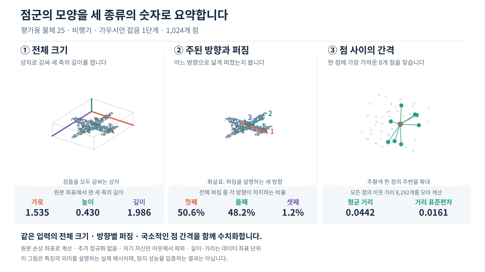

**그림 1. Geometry 설명.** 실제 test의 비행기 물체 ID 25에 Gaussian level 1이 적용된 1,024개 점을 사용했다. 특징의 의미를 설명하는 그림이며, 성능 개선을 입증하는 비교 그림은 아니다. [원본 PNG](results/figures/presentation_geometry_explainer.png) · [실측 특징값](results/figures/presentation_geometry_explainer_values.csv)

| 특징군 | 개수 | 실제 계산 | 이 정보를 넣은 이유 |
|---|---:|---|---|
| Bounding box | 3 | x·y·z축 각각의 `최댓값−최솟값` | 점군 전체 범위와 축별 크기를 요약한다. |
| PCA 비율 | 3 | 중심화한 좌표 공분산의 고윳값을 큰 순서로 정렬한 뒤 합으로 나눈다. | 점들이 주로 어느 방향에 얼마나 퍼져 있는지 요약한다. |
| kNN 거리 | 2 | 각 점에서 가까운 이웃 8개까지의 거리를 모두 모아 평균·표준편차를 낸다. | 점 사이 간격의 전반적인 크기와 불균일함을 요약한다. |

PCA를 처음 접한다면, 점군을 가장 넓게 펼쳐 보이는 방향부터 세 방향을 찾는다고 생각하면 된다. 첫 비율이 매우 크면 한 방향의 퍼짐이 두드러지고, 세 번째 비율이 작으면 상대적으로 얇은 구조일 수 있다. 이 수치 자체가 손상 여부의 정답은 아니다. 원래 가늘거나 평평한 물체도 있기 때문이다.

kNN의 `k=8`은 한 점의 가까운 이웃을 8개 본다는 뜻이다. **자기 자신의 인덱스만 제외하고**, 좌표가 같더라도 서로 다른 점은 유지한다. 1,024점이면 총 8,192개의 이웃 거리를 모아 통계량을 구한다. 그림 오른쪽의 확대 영역은 한 점 주변의 예시이며, 두 최종 통계량은 전체 점에서 계산한다.

Geometry는 **손상된 원본 XYZ**에서 계산했다. 이를 매번 별도로 크기 정규화하면 bbox나 거리의 변화가 지워질 수 있으므로, 모델 추론용 처리와 기하 특징 계산 경로를 구분했다. PCA 비율만이 아니라 bbox와 거리도 사용하므로, 모든 geometry 특징이 회전이나 크기 변화에 불변이라고 설명해서는 안 된다.

이 8개는 크기·전체 퍼짐·지역 간격을 비교적 간단한 통계로 함께 표현하려고 선택했다. 모든 가능한 기하 특징을 시험해 최적인 조합을 찾은 결과는 아니다. 현재 실험은 **명세에 정한 8개 특징 묶음이 추가로 유용한지**를 검증한다.

### 2.5 한 행의 의미와 데이터 누수 방지

한 행은 **원본 물체 하나의 손상 버전 하나**다. 같은 의자에 Gaussian level 1을 적용한 행과 Cutout level 5를 적용한 행은 입력은 달라도 원본 물체가 같다.

이 행들을 무작위로 나누면 같은 의자의 비슷한 모양을 train과 test에서 모두 볼 수 있다. 그렇게 얻은 성능은 새 물체에 대한 성능을 과하게 좋게 보여 줄 위험이 있다. 이를 막기 위해 **원본 물체 ID부터 나누고 그 물체의 75개 손상 버전을 같은 split에 넣었다.** 클래스 비율을 가능한 한 유지했고 seed는 42로 고정했다.

| 탐지기용 분할 | 원본 물체 수 | 손상 입력 행 수 | 역할 |
|---|---:|---:|---|
| Train | 1,480 | 111,000 | 탐지기의 학습 |
| Validation | 494 | 37,050 | 설정 선택, early stopping, F1 임계값 결정 |
| Test | 494 | 37,050 | 선택이 끝난 방법의 최종 성능 평가 |
| 합계 | 2,468 | 185,100 | 물체별 75조건 |

세 split의 원본 ID 교집합은 0이다. 185,100행을 서로 독립인 물체 185,100개로 해석하면 안 된다. 실제 서로 다른 원본 물체는 2,468개다. [저장된 분할](configs/object_splits.csv)

탐지기 입력에는 confidence 3개와 geometry 8개만 허용했다. 정답·예측 클래스 ID, 원본 ID, 손상 이름, level, split은 입력 특징에서 제외했다. 이 정보들은 결과를 결합하고 분석하는 데만 사용했다. 정답은 학습 타깃을 만드는 데 사용한다.

여기서 train/validation/test는 **오분류 탐지기용 분할**이다. 이미 학습된 PointNet을 다시 학습하는 분할이 아니다. 공식 분류 평가용 물체들을 탐지기용으로 다시 나누고, 탐지기가 학습하지 않은 물체에서 최종 평가했다. 손상 유형 15종 자체는 train에서도 관찰하므로, 처음 보는 손상 유형에 대한 실험과는 다르다.

### 2.6 왜 이 비교 모델들을 골랐는가

| 방법 | 입력 | 비교에서 확인하려는 점 |
|---|---|---|
| `1−MSP` | 최고 클래스 확률 1개 | 학습 없이 confidence만 낮은 순서로 검토하면 어느 정도인가? |
| LR confidence | confidence 3개 | 단순한 학습형 탐지기가 confidence를 조합하면 어떤가? |
| LR geometry | geometry 8개 | Geometry만으로도 오류와 관련된 정보를 얻는가? |
| LR combined | 총 11개 | LR에서도 geometry를 더하면 도움이 되는가? |
| LightGBM confidence | confidence 3개 | 핵심 비교의 기준 방법 |
| LightGBM geometry | geometry 8개 | 비선형 모델에서 geometry만의 정보는 어느 정도인가? |
| LightGBM combined | 총 11개 | 같은 탐지 알고리즘에서 geometry를 추가했을 때의 효과 |

**Logistic Regression(LR)**은 특징을 비교적 단순한 방식으로 결합하는 기준 모델이다. **LightGBM**은 여러 결정 트리를 이용해 특징의 비선형 관계와 조합을 학습하는 탐지기다. 예를 들어 confidence가 비슷해도 점 사이 간격의 분포가 다를 때 위험도를 다르게 정할 수 있다. 이것은 모델의 역할을 설명한 예이며, 실제로 어떤 특징을 사용했는지는 후반의 중요도 분석으로 살펴봤다.

핵심은 LR과 LightGBM의 승패를 정하는 것이 아니다. **동일한 LightGBM에서 confidence-only와 combined를 비교해야 geometry를 추가한 실용적 가치를 읽기 쉽다.** Geometry-only와 LR 결과는 이 결론을 보조하는 비교다.

### 2.7 설정을 어떻게 공정하게 골랐는가

LR은 train에서만 표준화를 학습하고, `C={0.1, 1, 10}` 중 validation AP가 가장 높은 값을 선택했다. 표준화는 특징마다 다른 값의 크기를 맞추는 처리이며, 그 기준도 test를 보지 않고 정했다. C는 학습한 계수가 지나치게 커지지 않도록 하는 규제의 강도를 조절하는 설정이다. 세 조합 모두 C=10이 선택됐다.

LightGBM은 세 조합에 모두 같은 탐색 예산을 줬다. `num_leaves={15, 31}` 두 후보를 비교하고, 최대 500개 트리, learning rate 0.05, validation AP 기준 early stopping 40회를 사용했다. 같은 test로 모든 최종 방법을 비교했다. Leaf는 결정 트리에서 최종 예측값을 내는 말단 구간이며, `num_leaves`는 그 개수의 상한이다. Early stopping 40회는 validation AP가 40회 연속 개선되지 않으면 트리 추가를 멈추는 규칙이다.

| LightGBM 입력 | 설정한 최대 leaf 수 | 사용된 트리 수 |
|---|---:|---:|
| Confidence | 31 | 111 |
| Geometry | 31 | 355 |
| Combined | 15 | 443 |

따라서 **“같은 알고리즘과 동일한 탐색 예산”**이라고 표현해야 한다. 선택된 모든 설정이나 모델 복잡도가 같지는 않다. Geometry를 추가하면서 모델이 학습한 구조도 달라지므로, 정보의 효과와 모델 복잡도의 효과를 완전히 분리한 인과 실험이라고 주장하지 않는다. [모델 선택 기록](results/tables/model_selection.json)

### 2.8 어떤 지표로 잘됐다고 판단하는가

오분류 탐지에서는 **틀린 입력을 양성(1)**으로 놓는다. 위험 점수가 클수록 먼저 검토한다.

| 지표 | 쉬운 의미 | 읽는 방향·주의점 |
|---|---|---|
| AP | 여러 검토 범위를 통틀어 오답을 앞쪽에 잘 모으는지 요약 | 클수록 좋다. 40개 클래스 분류 정확도가 아니다. |
| AUROC | 오답에 정답보다 높은 위험 점수를 주는 정도 | 클수록 좋다. 무작위 순위 기준은 0.5다. |
| 10%·20% 포착률 | 정해진 개수만 검토할 때 전체 오답 중 몇 %가 포함되는가 | 클수록 좋다. 분모는 test 전체 오답 수다. |
| F1 | 특정 임계값에서 오류 탐지 precision과 recall을 함께 평가 | 임계값은 validation에서 선택하고 test에 고정한다. |
| Brier score | 출력한 오류 확률과 실제 정오 사이의 제곱 오차 | 작을수록 좋다. 학습형 탐지기의 보정하지 않은 출력에 계산했다. |
| Risk–coverage | 고위험 입력을 제외한 뒤 남은 입력의 비율과 오류율 관계 | 같은 비율을 남길 때 남은 오류율이 낮은지 본다. |

AP는 코드의 `average_precision_score`다. 위험도 임계값을 바꿀 때 얻는 precision을 recall 증가량으로 가중해 요약한다. 단순한 PR 곡선의 사다리꼴 적분과 계산법을 섞지 않도록 문서와 표에서는 **AP**로 통일했다. Test의 실제 오류 비율인 **0.27884**를 무작위 순위의 비교 기준으로 함께 표시했다.

검토 예산이 `q`, test 입력 수가 `N`이면 높은 위험 점수 순서로 `ceil(q×N)`개를 고른다. 점수가 같을 때는 원본 ID·손상 이름·level 오름차순이라는 공통 규칙을 적용한다.

> **포착률 = 검토 목록에 포함된 오분류 수 ÷ test 전체 오분류 수**

예산별 순위 평가는 상위 입력 개수를 고정하므로 F1용 임계값에 의존하지 않는다. 또한 `1−MSP`는 PointNet의 예측이 틀릴 확률로 보정된 값이 아니므로 Brier 표에서는 제외했다.

### 2.9 왜 파일럿·조건별 캐시·독립 검증이 필요한가

점군 파일을 읽는 순서나 조인 방식이 틀리면 다른 물체의 예측과 특징이 잘못 결합될 수 있다. 그래서 먼저 작은 파일럿으로 추론→특징 추출→결합→탐지 평가 전체를 실제 실행했다.

전체 실행은 조건별로 결과를 저장했다. 재실행할 때는 데이터·체크포인트·코드 등 관련 hash와 캐시 내용을 확인해 유효한 조건만 재사용한다. 다운로드나 실행이 중단돼도 처음부터 전부 다시 계산할 필요가 없도록 설계한 것이다.

검증에서는 행 수와 원본 ID, 중복·누락·비유한값, split 교집합을 확인하고, 저장된 logits에서 confidence와 타깃·지표를 다시 계산했다. Geometry는 raw 좌표의 표본을 독립 계산과 대조했다. 평가 불확실성을 볼 때도 행이 아니라 원본 물체를 묶어 재표집했다. 같은 물체의 여러 손상 행이 관련되어 있기 때문이다.

세부 정의는 [실험 명세](doc/EXPERIMENT_SPEC.md), 검증 결과는 [전체 독립 감사](results/audit.json)에 있다.

## 3. Experiment — 실제로 무엇을 했고 무엇을 얻었는가

**5줄 요약**

1. 공식 ModelNet40-C의 15종×5개 level, 총 185,100행을 실행했고 최종 탐지 평가는 test 494개 물체·37,050행에서 수행했다.
2. PointNet의 clean accuracy는 90.6807%였고, 400행 파일럿과 전체 데이터의 누락·중복·분할 검증을 통과했다.
3. 같은 LightGBM에서 geometry를 추가하자 AP가 0.70691→0.80545로 0.09854 높아졌다.
4. 10% 검토에서는 오류 포착이 388건·3.76pp, 20%에서는 493건·4.77pp 순증했다.
5. 전체 혼합 조건의 결과는 개선됐지만 조건별로는 41개 개선·34개 악화였으므로, 사례와 한계를 함께 보여 준다.

### 3.1 사용한 데이터와 실험 범위

| 항목 | 실제 사용 범위 |
|---|---|
| 데이터 출처 | 공식 ModelNet40-C 배포본, 공식 평가 설정에 맞는 ModelNet40 clean HDF5 미러(물체 대응·정확도 검증) |
| 물체 클래스 | 40개 |
| 원본 물체 | 2,468개 |
| 손상 조건 | 15개 손상 유형×5개 level=75개 |
| 전체 손상 입력 | 2,468×75=185,100행 |
| 입력당 점 수 | 조건에 따라 649~2,048개 |
| 최종 탐지 평가 | Test 494개 물체×75조건=37,050행 |
| Test의 실제 오분류 | 10,331건, 전체 test의 27.8839% |
| 고정 분류기 | 공식 표준 학습 PointNet 체크포인트 1개 |
| 실행 환경 | `pfp` conda 환경, Python 3.11, CUDA용 PyTorch, GPU 추론과 CPU 기하 계산 |

15개 손상 유형은 `uniform`, `gaussian`, `background`, `impulse`, `upsampling`, `distortion`, `distortion_rbf`, `distortion_rbf_inv`, `density`, `density_inc`, `shear`, `rotation`, `cutout`, `occlusion`, `lidar`다. 이들은 점 위치의 변화, 누락, 밀도 변화 등 서로 다른 입력 변화를 포함한다.

**LiDAR와 Occlusion의 level은 관측 각도 차이**다. 모든 유형에서 level 1→5를 손상이 점점 심해지는 순서로 읽으면 안 된다. 75는 데이터의 조건 수이며, 75개의 PointNet을 학습했다는 뜻도 아니다.

데이터 파일은 조건별로 읽어 처리했고, 추론 결과와 특징을 조건별 캐시에 저장했다. 전체 데이터·가중치·대용량 캐시는 공개 레포에 넣지 않았다. 출처·체크포인트 hash·환경은 [자산 기록](doc/ASSET_PROVENANCE.md), [환경 기록](results/environment.json), [README](README.md)에 있다.

### 3.2 실제 실행 순서와 검증 결과

| 단계 | 실제로 한 일 | 결과 |
|---|---|---|
| 분류기 재현 점검 | 고정 checkpoint로 clean 평가, 공식 wrapper와 출력 대조 | Clean 2,238/2,468 정답, 실제 대조 배치의 출력 최대 차이 0 |
| 원본 분할 저장 | 원본 ID 기준 train/validation/test 생성 | 1,480/494/494개 물체, split 교집합 0 |
| 파일럿 | Gaussian·Cutout level 1·5, train 60개+validation 40개 물체 | 공통 100개 물체×4조건=400행, 추론부터 평가까지 연결 성공 |
| 전체 실행 | 75조건의 PointNet 추론·geometry 계산·결합 | 75/75조건, 185,100행, 물체마다 75조건 확인 |
| 탐지 평가 | 같은 test에서 기준선과 LR·LightGBM의 세 조합 비교 | 7개 비교 조건의 점수·순위·지표 저장 |
| 독립 검증 | 저장 logits·hash 검증 후 confidence·타깃 재계산, 저장 탐지기 점수·순위·지표 대조, geometry 표본 대조 | 누락·중복·비유한 특징·split 교집합 모두 0 |

파일럿은 train과 validation에 속한 물체만 사용했고, test 물체를 파일럿 조정에 사용하지 않았다. 전체 입력 파일 77개(손상 75개와 label·original)의 크기와 CRC32를 공식 배포 메타데이터에 대조하고 저장 파일의 SHA-256도 확인했다. ZIP 전체를 재구성한 MD5 검증과는 구분한다.

Geometry는 손상 유형별 raw 좌표 표본 15개를 완전 거리 계산과 공분산 계산으로 독립 대조했고, 최대 차이는 약 `1.67×10⁻¹⁶`이었다. 이것은 geometry 모든 행을 다른 구현으로 다시 계산했다는 뜻은 아니다. 저장된 logits에서 confidence와 정오를 재계산한 검증은 전체 185,100행에, 최종 탐지 점수·순위·지표 대조는 test 37,050행에 적용했다. 감사 과정에서 PointNet 추론 전체를 새로 실행했다는 뜻은 아니다.

Clean 데이터와 손상 데이터의 원본 대응도 확인했다. 2,468개 물체 전체에서 `data_original`의 1,024점이 clean 2,048점의 정확한 부분집합이었고, 라벨과 원본 파일명도 대응했다. 뒤의 실제 사례 그림은 이 검증을 바탕으로 같은 물체의 기준 점군과 손상 점군을 나란히 표시한다.

[파일럿 결과](results/pilot/validation.json) · [전체 감사](results/audit.json) · [데이터 검증](results/data_download_validation.json) · [물체 대응 검증](results/data_alignment.json)

### 3.3 PointNet은 어떤 입력에서 자주 틀렸는가

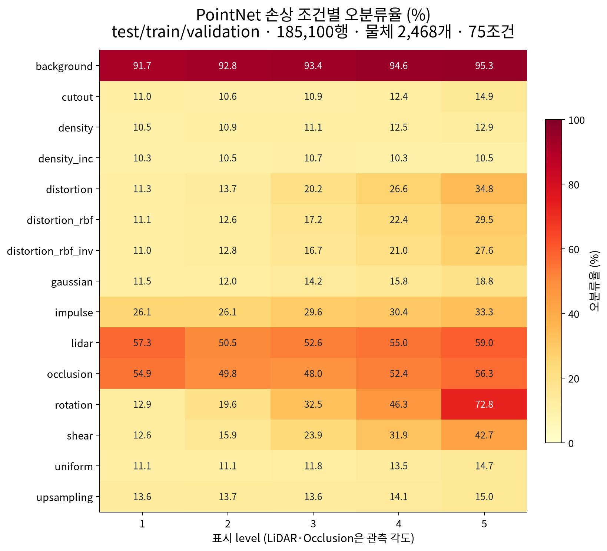

**그림 2. PointNet의 손상별 오류율.** 각 칸은 해당 손상·level의 2,468개 입력에서 측정했다. 색이 진할수록 오류율이 높고, 색 범위는 0~100%다. **전체 물체 185,100행에 대한 robustness 분석**이며, 탐지기 최종 test 37,050행과 모집단이 다르다. [원본 PNG](results/figures/corruption_heatmap.png)

Clean accuracy는 **90.6807%**, 전체 손상 입력의 오류율은 **52,400/185,100=28.3090%**였다. 전체 손상 accuracy는 71.6910%다. Clean과 손상은 입력 조건이 다르므로 이 둘은 분류기의 견고성을 보는 비교다. Geometry 탐지기를 붙인 뒤의 분류 정확도로 해석하면 안 된다.

Background level 5의 오류율은 **95.30%**, density_inc level 1은 **10.29%**였다. 손상 유형에 따라 실패 빈도가 크게 달랐다는 결과다. 이 차이는 여러 조건이 섞인 입력을 한꺼번에 검토할 때, 위험한 입력을 구분할 실용적인 여지가 있음을 보여 준다.

전체 통합 클래스별 오류율과 정답·오답 confidence 분포도 저장했다. 다만 모든 손상×level×클래스의 3원 교차 분석을 모두 끝냈다는 의미는 아니다. [조건별 표](results/tables/robustness_by_condition.csv) · [통합 클래스별 표](results/tables/robustness_by_class.csv)

### 3.4 핵심 성과: confidence에 geometry를 추가하면 도움이 되었는가

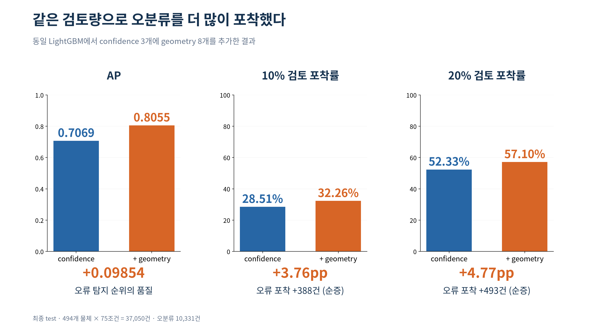

**그림 3. 가장 먼저 보여 줄 핵심 비교.** 파랑은 LightGBM confidence, 주황은 같은 알고리즘의 combined다. AP와 포착률 막대는 각각 0~1과 0~100% 축으로 표시했다. 모두 같은 최종 test 37,050행의 실측값이다. [원본 PNG](results/figures/presentation_main_gains.png)

| 지표 | LightGBM confidence | LightGBM combined | 차이 |
|---|---:|---:|---:|
| AP | 0.70691 | 0.80545 | **+0.09854** |
| AUROC | 0.87583 | 0.91347 | +0.03764 |
| 10% 검토 포착률 | 28.51% | 32.26% | **+3.76pp** |
| 20% 검토 포착률 | 52.33% | 57.10% | **+4.77pp** |

이 실험에서 핵심 연구 질문에 대한 답은 **“여러 손상 조건이 섞인 최종 test에서는 도움이 되었다”**이다. PointNet 분류 결과는 그대로 두었지만, 오류가 포함된 입력을 먼저 고르는 순위가 좋아졌다.

아래는 보조 비교까지 포함한 7가지 결과다.

| 오분류 탐지 방법 | AP | AUROC | 10% 포착률 | 20% 포착률 |
|---|---:|---:|---:|---:|
| 1−MSP | 0.7020 | 0.8691 | 28.32% | 51.93% |
| LR confidence | 0.7026 | 0.8697 | 28.29% | 52.08% |
| LR geometry | 0.6173 | 0.7478 | 29.55% | 44.41% |
| LR combined | 0.7776 | 0.8984 | 31.18% | 56.06% |
| LightGBM confidence | 0.7069 | 0.8758 | 28.51% | 52.33% |
| LightGBM geometry | 0.7022 | 0.8225 | 31.35% | 51.16% |
| **LightGBM combined** | **0.8055** | **0.9135** | **32.26%** | **57.10%** |

여기서 읽을 점은 세 가지다. 첫째, LR에서도 geometry를 추가하면 AP가 0.7026→0.7776으로 높아졌다. 둘째, geometry-only가 confidence-only를 모든 지표에서 이긴 것은 아니지만 둘을 결합한 모델의 핵심 지표가 가장 좋았다. 셋째, geometry-only LightGBM은 confidence-only보다 AP가 조금 낮으면서 10% 포착률은 높았다. **전체 순위 요약과 특정 검토 예산의 성과가 항상 같은 순서일 필요는 없다.**

[최종 탐지 지표 CSV](results/tables/detection_metrics.csv) · [PPT에 넣을 전체 비교표 그림](results/figures/detection_comparison.png)

### 3.5 같은 검토 예산에서 실제로 몇 건 더 찾았는가

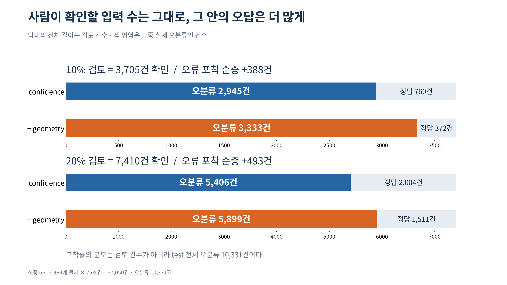

**그림 4. 같은 개수만 확인한 결과.** 10%에서는 두 방법 모두 3,705건, 20%에서는 모두 7,410건을 검토한다. 색 영역은 실제 오답, 회색은 원래 정답이다. 주황 막대의 오답 부분이 더 크다는 것은 같은 개수의 입력을 확인해 더 많은 오류를 골랐다는 뜻이다. [원본 PNG](results/figures/presentation_review_outcomes.png)

| 예산 | 검토 입력 수 | Confidence 포착 오류 | Combined 포착 오류 | 포착 수 순증 |
|---|---:|---:|---:|---:|
| 10% | 3,705 | 2,945 | 3,333 | **388건** |
| 20% | 7,410 | 5,406 | 5,899 | **493건** |

10% 결과를 직접 계산하면 다음과 같다.

- Confidence 포착률: `2,945 ÷ 10,331 × 100 = 28.51%`
- Combined 포착률: `3,333 ÷ 10,331 × 100 = 32.26%`
- 포착 수 차이: `3,333 − 2,945 = 388건`
- 포착률 차이: `(3,333 − 2,945) ÷ 10,331 × 100 = 3.76pp`

**32.26%는 검토한 입력 중 오답 비율이 아니다.** 검토한 3,705건 중 오답은 `3,333/3,705=89.96%`다. 이 값은 검토 목록의 precision이고, 32.26%는 전체 오답을 기준으로 한 recall이다. Confidence의 같은 precision은 79.49%다. 이 precision은 핵심 결과의 분자·분모를 이해하기 위해 추가 계산한 설명값이며, 명세의 핵심 비교는 AP와 포착률이다.

또한 오답이 전체 test의 27.88%이므로, 10%만 검토해서 모든 오답을 잡을 수는 없다. 검토한 3,705건이 전부 오답이라고 해도 포착률의 최대는 `3,705/10,331=35.86%`다. 이론상 상한과 실제 포착률 32.26%를 구분하면 숫자의 크기를 이해하기 쉽다.

`pp`는 퍼센트포인트다. 28.51%→32.26%의 차이는 원래 실측값으로 계산하면 3.76pp이며, 상대 증가율로는 약 13.17%다. 발표에서는 혼동을 줄이기 위해 **+388건, +3.76pp**를 우선 사용한다. 표의 반올림 값끼리 빼면 끝자리 차이가 날 수 있으므로 차이는 반올림 전 값으로 계산한다.

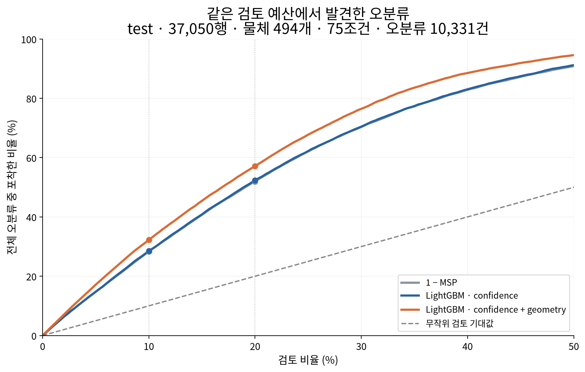

**그림 5. 검토 예산 그래프.** 가로축은 검토하는 입력의 비율, 세로축은 전체 오류 중 포착한 비율이다. 10%와 20%가 핵심 비교 지점이다. 무작위 검토라면 기대 포착률도 각각 10%·20%다. 이 곡선은 사람의 실제 오류 수정률이 아니다. [원본 PNG](results/figures/review_budget.png)

### 3.6 +388건은 모두 새롭게 발견한 오류인가

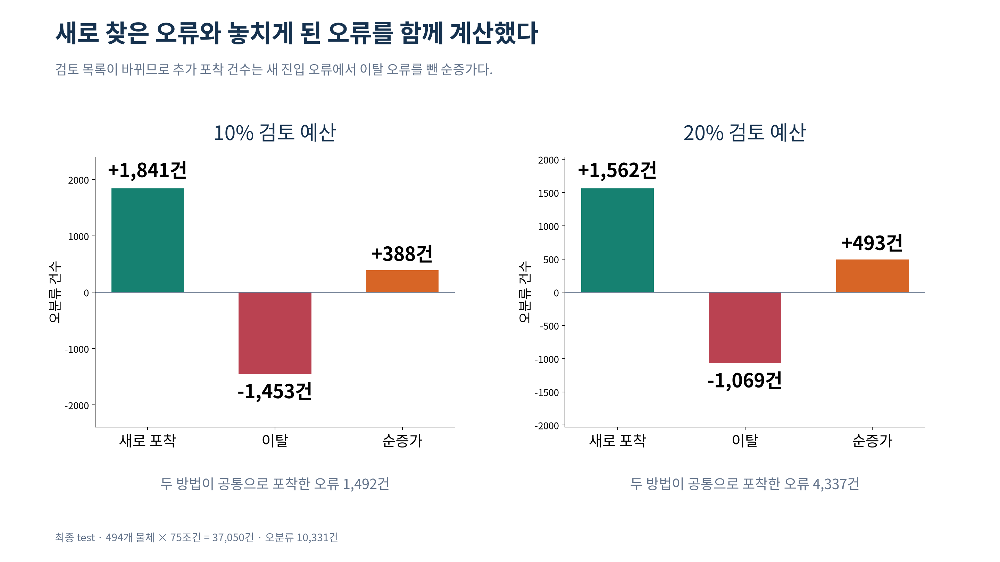

**그림 6. 새 진입과 이탈을 함께 계산한 순증.** Geometry를 추가하면 검토 목록에 새로 들어오는 오답도 있고, 반대로 빠지는 오답도 있다. [원본 PNG](results/figures/presentation_review_turnover.png)

| 예산 | 두 방법 공통 포착 | Combined만 포착 | Confidence만 포착 | 최종 순증 |
|---|---:|---:|---:|---:|
| 10% | 1,492 | 1,841 | 1,453 | 1,841−1,453=**388** |
| 20% | 4,337 | 1,562 | 1,069 | 1,562−1,069=**493** |

따라서 +388건은 **새 진입 1,841건에서 이탈 1,453건을 뺀 값**이다. Geometry를 더한 목록이 기존 목록을 그대로 포함하면서 오류만 추가한 것은 아니다. 또 한 건은 물체의 특정 손상 버전이므로, +388개 서로 다른 물체를 찾았다는 뜻도 아니다. [수치 manifest](results/figures/presentation_manifest.json)

### 3.7 실제 점군에서는 어떤 변화가 있었는가

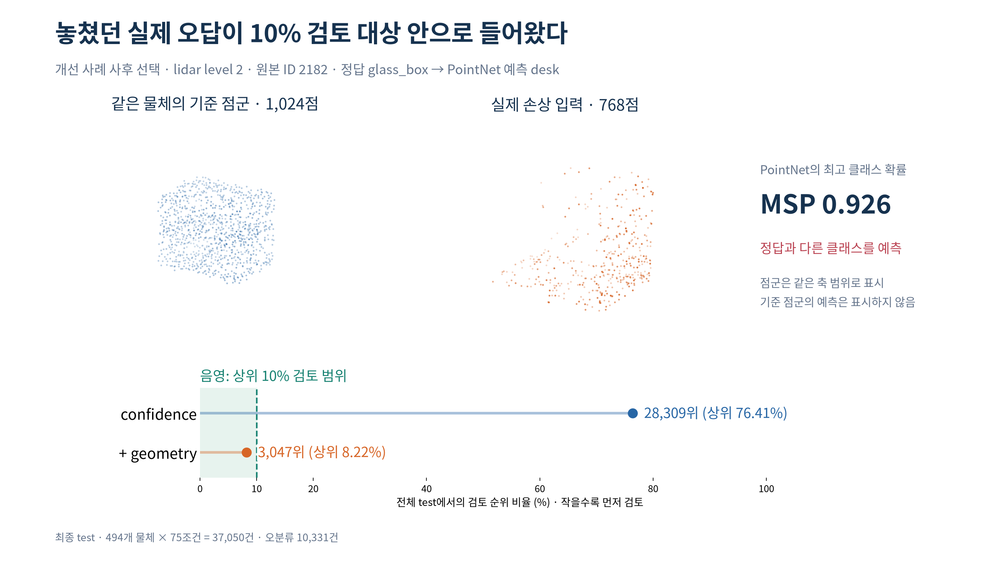

**그림 7. 10% 예산에서 새로 포착한 오답.** LiDAR level 2의 물체 ID 2182다. 정답은 `glass_box`인데 PointNet은 `desk`로 예측했고, MSP는 **0.92592**였다. Confidence 탐지기의 순위는 **28,309위**, combined는 **3,047위**였다. 10%의 경계인 3,705위 안에 combined만 들어왔다. [원본 PNG](results/figures/presentation_case_10.png)

높은 MSP의 오답이 confidence-only 검토 목록에서는 뒤에 있었지만, geometry를 함께 사용한 목록에서는 앞으로 이동한 예다. **MSP는 PointNet의 클래스 확률이고, 그림 아래 순위는 별도 탐지기의 위험 순위**다. 같은 종류의 확률이나 순위로 혼동하지 않는다.

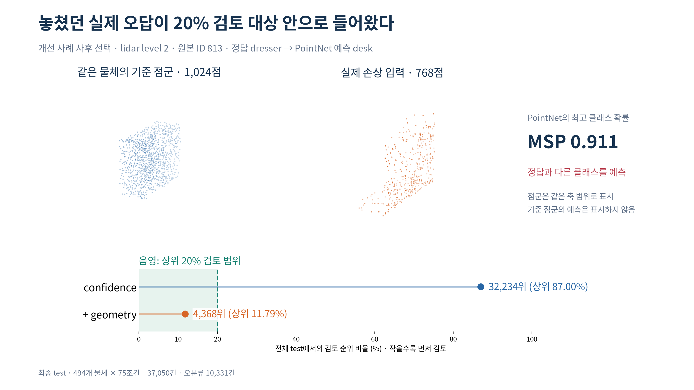

**그림 8. 20% 예산에서 새로 포착한 오답.** LiDAR level 2의 물체 ID 813이다. 정답 `dresser`를 `desk`로 예측했고 MSP는 **0.91081**이었다. 순위는 **32,234→4,368위**, 상위 비율은 **87.00→11.79%**로 바뀌었다. 20%에는 들지만 10%에는 들지 않는다. [원본 PNG](results/figures/presentation_case_20.png)

두 그림의 기준 점군과 손상 점군은 같은 축 범위로 표시했다. 기준 점군의 분류 결과를 이 그림에서 평가하거나 제시한 것은 아니다. 사례는 결과를 이해하기 위해 **사후 선택**했으며 평균적인 입력을 대표한다고 보장하지 않는다. 사례 선택으로 모델을 다시 학습하지도 않았다.

반대 사례도 있다. Upsampling level 5, ID 1205는 실제 `plant`를 `flower_pot`으로 예측한 오답인데, geometry 추가 후 순위가 **17,335→33,973위**로 내려갔다. 맞힌 입력이 높은 위험으로 선택되는 오경보도 있다. [개선·악화·오경보를 함께 보여 주는 기존 사례 그림](results/figures/pointcloud_cases.png)

전체 185,100행의 오답 52,400건 중 MSP≥0.9인 오답은 **478건**이다. 높은 confidence의 오답이 존재한다는 사실을 보여 주는 것이며, 대부분의 오답이 높은 confidence였다고 주장하지 않는다. [Confidence 분포 그림](results/figures/confidence_distribution.png)

### 3.8 개선이 큰 조건만 보면 어떤가, 전체 범위는 어떤가

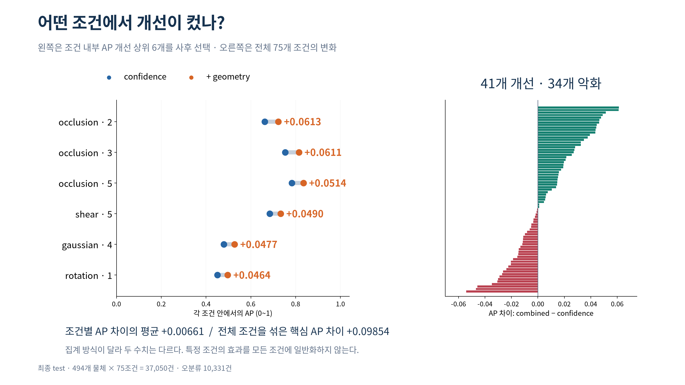

**그림 9. 조건별 성과와 예외.** 왼쪽은 AP 차이가 큰 6개 조건을 사후 선택한 것이고, 오른쪽은 전체 75개 조건이다. 각 조건의 평가는 같은 test 물체 494개에서 계산했다. [원본 PNG](results/figures/presentation_condition_highlights.png)

최대 개선은 **Occlusion level 2, AP +0.06125**였고, 최대 악화는 **Cutout level 5, AP −0.05419**였다. 75조건 중 AP가 좋아진 조건은 **41개**, 나빠진 조건은 **34개**다. 5개 level을 합쳐 15개 손상 유형으로 보면 10개 개선·5개 악화다. 이 두 개수는 집계 단위가 다르다.

핵심 결과의 AP 차이 **+0.09854**와 75조건 각각의 AP 차이를 평균한 **+0.00661**도 다른 지표다.

| 집계 | 실제로 정렬하는 대상 | AP 변화 |
|---|---|---:|
| 전체 혼합 조건 | 모든 손상 입력 37,050건을 한꺼번에 정렬 | 0.70691→0.80545, **+0.09854** |
| 조건 내부 평가의 단순평균 | 조건마다 494건을 따로 정렬한 뒤 75개 AP를 평균 | 0.62021→0.62682, **+0.00661** |

전체 혼합 평가는 서로 다른 손상 조건 **사이**의 위험 순서를 정하는 능력도 포함한다. AP는 조건별 AP를 단순 평균한 값과 같지 않다. 이번 연구 질문은 여러 손상 입력을 한 목록에서 검토하는 상황이므로 전체 혼합 성과가 핵심이지만, 이를 모든 손상에서 일관된 큰 개선으로 일반화해서는 안 된다.

[조건별 원본 표](results/tables/geometry_delta_by_condition.csv) · [15개 유형으로 합친 그림](results/figures/condition_deltas.png)

### 3.9 어떤 특징이 활용됐는가

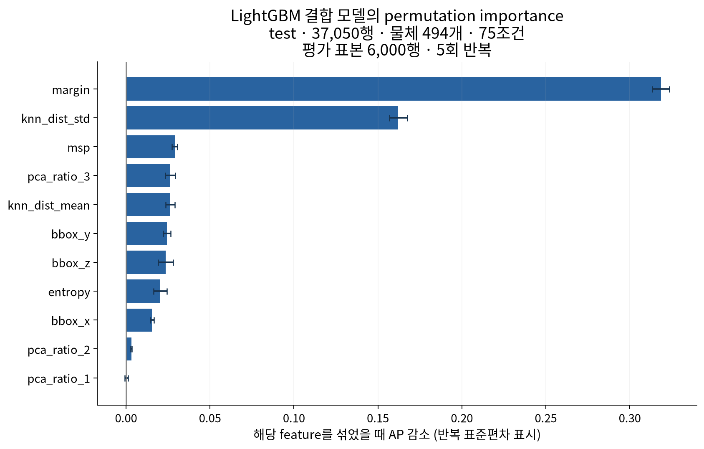

**그림 10. Feature 관련성.** Combined LightGBM의 test 6,000행에서 특정 특징 값을 섞은 뒤 AP가 얼마나 내려가는지 5회 반복 측정했다. 감소가 크면 해당 모델의 예측이 그 정보에 많이 의존했음을 시사한다. [원본 PNG](results/figures/feature_importance.png)

AP 감소량은 confidence 특징인 **margin 0.31849**, geometry 특징인 **knn_dist_std 0.16209**가 컸다. 즉 이번 결합 모델은 클래스 확률 차이뿐 아니라 이웃 거리의 불균일함과 관련된 정보도 활용했다.

이 값은 “해당 특징이 AP를 그만큼 올렸다”는 독립 기여도나 인과효과가 아니다. 서로 관련된 특징을 하나만 섞으면 원래 데이터와 다른 조합이 생길 수 있고, 모델의 의존 정도도 달라진다. 해석은 **이 모델에서 관찰된 관련성**으로 제한한다. 이 분석을 본 뒤 test에 맞춰 특징을 다시 고르거나 재학습하지 않았다.

제안서의 특징 해석 목적은 **SHAP 대신 held-out permutation importance**로 수행했다. SHAP을 실행했다고 표현하지 않는다. [중요도 원본 표](results/tables/permutation_importance.csv)

### 3.10 불확실성과 보조 지표도 확인했는가

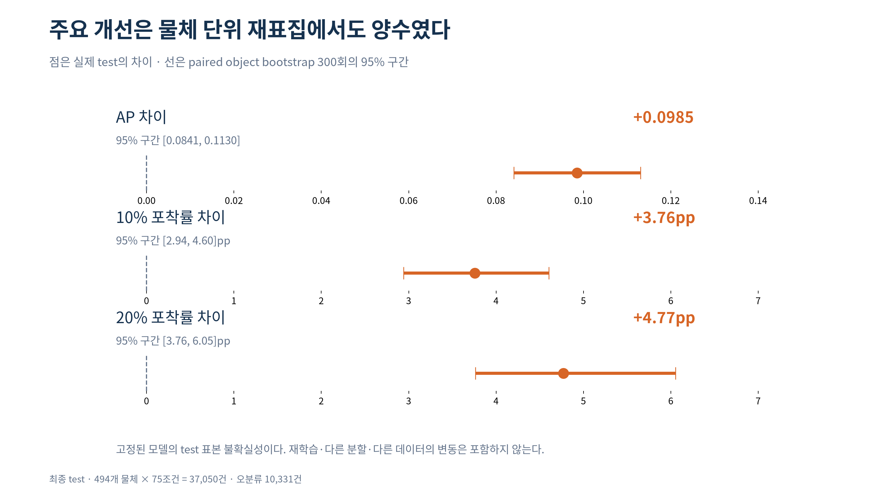

**그림 11. 개선량의 95% 구간.** Test 원본 물체 494개를 300회 재표집했다. 같은 물체의 75개 손상 행을 함께 뽑고, 각 재표집에서 두 방법의 차이를 계산했다. 점은 실제 test의 차이이며 선은 bootstrap 구간이다. [원본 PNG](results/figures/presentation_gain_intervals.png)

| 차이 | 실제 관측값 | Bootstrap 95% 구간 |
|---|---:|---:|
| AP | +0.09854 | [0.08410, 0.11304] |
| 10% 포착률 | +3.76pp | [2.94, 4.60]pp |
| 20% 포착률 | +4.77pp | [3.76, 6.05]pp |

세 구간이 모두 0보다 크므로 이 고정 모델과 test 표본에서 관측한 양의 차이를 뒷받침한다. 다만 새로운 split, 다른 seed로 재학습한 모델, 다른 분류기, 실제 센서 환경까지 포함하는 구간은 아니다. [Bootstrap 원본](results/tables/paired_bootstrap.json)

| 보조 지표 | Confidence LightGBM | Combined LightGBM | 해석 |
|---|---:|---:|---|
| 탐지 F1 | 0.6854 | 0.7413 | Validation에서 정한 각 모델의 임계값을 test에 적용했다. |
| Brier | 0.12556 | 0.10434 | 보정하지 않은 오류 확률의 제곱 오차가 낮아졌다. |
| 고위험 20% 제외 후 남은 오류율 | 16.62% | 14.95% | 남은 29,640건에서 오류 비율이 낮아졌다. |

마지막 결과는 입력을 제외한 뒤 남은 집합의 성질을 보여 준다. 제외한 오답을 실제로 고쳤다는 뜻은 아니다. [Risk–coverage 그림](results/figures/risk_coverage.png)

### 3.11 제안서 대비 수행 범위와 최종 해석

| 구분 | 실제 상태 |
|---|---|
| 손상별 실패 분석 | 15×5 오류율, 유형별 accuracy·macro-F1, 전체 통합 클래스별 오류율, 정답·오답 confidence 분포 완료 |
| Confidence·geometry 비교 | 3개 특징 조합, LR·LightGBM 및 1−MSP 기준선, 같은 test 비교 완료 |
| 핵심·보조 지표 | AP·AUROC·검토 포착률·F1·Brier·risk–coverage 완료 |
| 특징 해석 | 명세에 따라 SHAP 대신 held-out permutation importance 사용 |
| Geometry 후보 구체화 | 명세의 8개 특징 사용. kNN 거리의 평균·표준편차를 사용하며, 별도 local density나 공간 분산 특징을 추가하지 않음 |
| 불확실성 | 물체 단위 paired bootstrap 300회 완료 |
| 선택적 확장 | PointNet++·DGCNN, 미관측 손상 유형 실험은 수행하지 않음 |
| 현실 적용 검증 | 실제 센서 배포, 사람이 오류를 수정한 비율, 실제 검토 시간·재촬영 효과는 측정하지 않음 |

따라서 최종 결론은 다음 범위로 정리한다.

> **사용한 PointNet과 ModelNet40-C에서, 75개 손상 조건이 섞인 새 물체의 입력을 검토할 때 confidence에 geometry를 추가하면 같은 검토 예산에서 오분류를 더 많이 포착했다. 다만 모든 개별 손상 조건에서 좋아진 것은 아니다.**

## 4. 발표 구성과 필수 내용

**5줄 요약**

1. 발표는 문제와 실제 사례에서 출발해, 설계 이유·공정한 비교·핵심 성과·한계 순서로 구성한다.
2. 10분 중 9분 30초 분량으로 준비하고, 가장 중요한 AP와 10%·20% 포착 결과에 충분한 시간을 배정한다.
3. 데이터 규모, 물체 ID 분할, 두 모델의 역할, 같은 LightGBM 비교, 지표의 분모는 반드시 포함한다.
4. 핵심 그림은 큰 숫자·동일 검토량·실제 사례·geometry 설명을 중심으로 고르고, 세부 검증은 보조 자료로 둔다.
5. 전체 혼합 성과와 조건별 예외를 함께 제시하고, 실제 수정 효과나 미검증 환경까지 결론을 넓히지 않는다.

### 4.1 10분 안에 어떤 순서로 전달할까

아래는 **내용별 시간 배분과 포함 요소**다. 슬라이드별 대본이나 발표자 노트가 아니며, 실제 장수와 디자인은 발표자가 조정하면 된다. 목표 분량은 9분 30초이고 남은 30초는 전환과 발화 속도 차이를 위한 여유다.

| 시간 | 내용 | 꼭 전달할 핵심 | 사용할 자료 |
|---|---|---|---|
| 0:00~0:50 | 문제와 연구 질문 | 제한된 검토량으로 먼저 볼 오답을 고른다. Confidence에 geometry를 더할 이유를 제시한다. | 연구 질문, 실제 사례 그림의 간단한 미리보기 |
| 0:50~1:50 | 데이터와 검증 분할 | 2,468개 원본 물체, 75조건, 185,100행. 같은 물체의 변형은 한 split에 넣었다. | 데이터·split 표 |
| 1:50~3:15 | 해결 방법과 선택 이유 | PointNet 고정, 별도 탐지기 학습, confidence 3개와 geometry 8개, 같은 LightGBM 비교. | Geometry 설명 그림, 두 모델 역할 표 |
| 3:15~4:10 | 기본 재현과 실패 분석 | Clean 90.6807%, 전체 손상 오류율 28.3090%, 조건별 실패 차이. | 손상 히트맵 |
| 4:10~5:25 | 핵심 탐지 성과 | AP 0.70691→0.80545. Confidence-only 대비 geometry 추가의 차이를 강조한다. | 핵심 개선 그림, 필요하면 7개 방법 비교표 |
| 5:25~6:55 | 같은 검토 예산의 의미 | 10% +388건·3.76pp, 20% +493건·4.77pp. 포착률의 분모는 전체 오답이다. | 같은 검토 개수 그림, 검토 예산 곡선 중 선택 |
| 6:55~8:10 | 실제 사례와 해석 | 높은 MSP의 오답이 10% 검토 범위에 들어온 과정, 활용된 geometry의 의미. | 실제 10% 사례, 필요하면 중요도 그림 |
| 8:10~9:30 | 한계·결론·기여 | 41조건 개선·34조건 악화, 적용 범위, 두 사람 역할. 질문에 대한 답을 명확히 마무리한다. | 조건별 그림의 전체 분포, 결론 요약 |

핵심 그림 3과 그림 4가 발표의 중심이다. 시간이 부족하면 모든 보조 지표를 읽기보다 **어떤 정보를 더했는지, 무엇과 공정하게 비교했는지, 같은 검토량으로 몇 건 더 찾았는지**를 분명히 전달한다. 반대로 조건별 예외와 적용 범위는 짧게라도 본문에서 포함해야 결론을 정확하게 이해할 수 있다.

### 4.2 반드시 들어가야 하는 내용

아래 체크박스는 **PPT 제작 시 확인할 점검표**다. 실험 미완료 항목을 뜻하지 않는다.

- [ ] **선정 이유:** 모든 결과를 검토하기 어려운 상황에서 제한된 검토량으로 오류를 찾고자 한다.
- [ ] **연구 질문:** confidence에 geometry를 추가하면 같은 검토 예산에서 오분류를 더 많이 포착하는가?
- [ ] **데이터 출처와 규모:** ModelNet40-C, 40개 클래스, 원본 2,468개, 손상 15×5조건, 총 185,100행.
- [ ] **모델 역할:** 40종 분류를 하는 PointNet은 고정하고, 오분류 위험을 판단하는 탐지기를 학습했다.
- [ ] **입력과 타깃:** confidence 3개+geometry 8개, `error=1`은 PointNet이 틀린 입력이다.
- [ ] **설계 이유:** 모델 출력과 입력 구조의 정보를 결합하고, LR와 LightGBM·세 조합으로 추가 가치를 확인한다.
- [ ] **누수 방지:** 원본 ID 분할 1,480/494/494, 같은 물체의 75개 손상은 같은 split, 교집합 0.
- [ ] **공정한 비교:** 같은 최종 test 37,050행, 동일 LightGBM과 동일 탐색 예산, validation에서 설정 결정.
- [ ] **핵심 실측:** AP +0.09854, 10% 포착 +388건·3.76pp, 20% +493건·4.77pp.
- [ ] **지표 해석:** 포착률 분모는 전체 오답 10,331건, 추가 건수는 순증, PointNet 정확도 개선과 구분.
- [ ] **실제 그림:** 결과 비교 그림과 실제 점군 사례를 포함하고 그림의 평가 범위도 보이게 한다.
- [ ] **검증 근거:** clean 재현, 파일럿·전체 무결성, 독립 지표 대조, 물체 단위 bootstrap의 존재를 설명한다.
- [ ] **예외와 한계:** 41조건 개선·34조건 악화, 다른 분류기·미관측 손상·실제 수정 효과는 검증하지 않음.
- [ ] **팀 기여:** 이정연의 실험 구현·실행·검증·해석과 이현택의 PPT 제작·발표 역할을 실제 수행 내용대로 표시.
- [ ] **시간:** 9분 30초를 목표로 리허설하고 10분 발표·3분 질의응답에 맞춘다.

### 4.3 그림은 무엇부터 고르면 좋은가

| 우선순위 | 자료 | 목적 |
|---|---|---|
| 우선 사용 | [핵심 개선](results/figures/presentation_main_gains.png) | AP와 10%·20% 포착률의 전후 차이를 한눈에 보여 준다. |
| 우선 사용 | [같은 검토 개수](results/figures/presentation_review_outcomes.png) | +388/+493건의 의미를 실제 건수로 설명한다. |
| 우선 사용 | [실제 10% 사례](results/figures/presentation_case_10.png) | 오답 하나가 검토 경계 안으로 이동하는 구체적인 모습을 보여 준다. |
| 우선 사용 | [Geometry 설명](results/figures/presentation_geometry_explainer.png) | PCA·bbox·kNN을 처음 듣는 사람도 어떤 입력 정보를 쓰는지 이해하게 한다. |
| 본문 또는 짧은 보조 | [손상 히트맵](results/figures/corruption_heatmap.png) | 분류기가 어떤 입력에서 어려움을 겪는지 전체 범위를 보여 준다. |
| 본문 또는 짧은 보조 | [조건별 개선과 전체 분포](results/figures/presentation_condition_highlights.png) | 큰 개선 사례와 41개 개선·34개 악화라는 전체 상황을 같이 보여 준다. |
| 설명이 더 필요할 때 | [검토 예산 곡선](results/figures/review_budget.png) | 예산을 바꿀 때 포착률이 어떻게 달라지는지 보여 준다. |
| 보조 자료 | [전체 7개 방법 비교](results/figures/detection_comparison.png) | 기준선·LR·geometry-only까지 비교했음을 보여 준다. |
| 보조 자료 | [진입·이탈](results/figures/presentation_review_turnover.png) | +388/+493이 순증이라는 질문에 답한다. |
| 보조 자료 | [실제 20% 사례](results/figures/presentation_case_20.png) | 10%와 20%의 경계가 다른 것을 설명한다. |
| 보조 자료 | [개선·악화·오경보 사례](results/figures/pointcloud_cases.png) | Geometry를 더해도 놓치는 오류와 오경보가 있음을 보여 준다. |
| 보조 자료 | [Feature importance](results/figures/feature_importance.png) | 탐지기가 활용한 특징의 관련성을 설명한다. |
| 보조 자료 | [개선 구간](results/figures/presentation_gain_intervals.png) | 고정 모델의 test 표본 불확실성을 설명한다. |
| 보조 자료 | [Risk–coverage](results/figures/risk_coverage.png) | 고위험 입력을 제외했을 때 남은 오류율을 보여 준다. |
| 보조 자료 | [Confidence 분포](results/figures/confidence_distribution.png) | 높은 confidence의 오답이 존재하되 대다수는 아님을 설명한다. |
| 보조 자료 | [15개 유형별 AP 차이](results/figures/condition_deltas.png) | 5개 level을 합친 유형별 개선·악화를 보여 준다. |

16개를 전부 본 발표에 넣을 필요는 없다. 핵심에 맞는 그림을 고르고, 자세한 비교와 검증은 질문에 대비한 보조 자료로 준비하면 된다. 추가 발표 그림은 16:9이고 PNG와 같은 이름의 PDF를 제공한다. 기존 그림은 내용에 맞는 비율이므로 크기를 조절하되 가로세로를 따로 늘려 왜곡하지 않는다.

색과 범례는 함께 유지한다. 결과 비교의 파랑은 confidence, 주황은 combined다. Geometry 설명 그림의 색은 축·방향·이웃을 구분하는 용도이므로 모델 비교 색과 의미가 다르다. 그림에서 평가 범위·축·분모·사후 선택 표시를 잘라내지 않는 것이 좋다.

### 4.4 채점 기준에 맞춰 무엇을 보여 줄까

| 채점 항목 | 배점 | 이 프로젝트에서 보여 줄 근거 |
|---|---:|---|
| 참신성 | 25 | 제한된 검토량으로 먼저 볼 오류를 고른다는 질문과 confidence 외에 geometry를 보는 가설 |
| 난이도 | 25 | PointNet 추론, 기하 특징 추출, 75조건 표 결합·캐시·복구, 7개 탐지 비교까지 연결한 실제 구현 |
| 연구 적절성 | 25 | ID 분할, 같은 test·같은 알고리즘 비교, 검증된 지표, 불확실성과 개선·악화 양쪽의 해석 |
| 발표 | 25 | 배경→방법→성과가 이어지는 구성, 쉬운 그림, 시간 준수, 용어·수치를 이해한 질의응답 |

난이도는 코드 파일 수나 사용한 도구 이름을 많이 나열해서 설명하기보다, **왜 같은 물체의 변형을 묶어야 했는지, 어떻게 여러 조건의 결과를 정확히 결합했는지, 어떤 검증으로 결과를 믿을 수 있게 했는지**로 설명하는 편이 명확하다. 이 프로젝트만으로 세계 최초의 방법이나 기존 모든 연구보다 우수한 성능을 주장할 근거는 없다.

[제안서·과제·채점기준 대조 문서](doc/REQUIREMENTS_REVIEW.md)

### 4.5 발표 전에 확인할 질문과 오해

| 예상 질문·오해 | 답변에 필요한 사실 |
|---|---|
| PointNet의 정확도가 80.55%로 개선된 것인가? | 0.80545는 오류 탐지 AP다. PointNet의 예측은 바뀌지 않았다. |
| 포착률 32.26%가 낮은 것 아닌가? | 전체 입력 10%만 검토한 결과다. 전체 오답이 10,331건이므로 해당 예산의 최대 포착률도 35.86%다. |
| +388건은 새롭게 찾은 오류 전체 수인가? | 새 진입 1,841건에서 기존에 포착했지만 이탈한 1,453건을 뺀 순증이다. |
| 같은 입력을 확인했는데 왜 오류 수가 다른가? | 동일한 것은 검토 개수다. 위험 순위가 달라져 선택한 입력은 다르다. |
| 정답을 알고 위험을 예측한 것 아닌가? | 학습 타깃과 평가에는 정답이 필요하지만 탐지기 입력에는 정답·ID·손상 이름·level을 넣지 않았다. |
| Geometry 때문에 좋아졌다고 단정할 수 있는가? | 같은 알고리즘과 탐색 예산에서 추가 정보의 실용적 효과를 비교했다. 선택된 트리 수·leaf 수는 달라 복잡도 효과까지 완전히 분리한 것은 아니다. |
| 왜 전체 AP 개선은 큰데 조건별 평균 개선은 작은가? | 전체 AP에는 서로 다른 조건 사이의 위험 순위도 포함된다. AP의 전체 계산과 조건별 평균은 서로 다르다. |
| 모든 손상이나 새로운 손상에도 통하는가? | 75조건 중 34조건은 AP가 악화했다. Train에서 본 손상 유형을 새 물체에 적용한 범위이며 미관측 손상은 시험하지 않았다. |
| Feature importance가 원인을 증명하는가? | 고정된 모델이 해당 정보에 의존한 정도를 관찰한 것이다. 특징 간 상관과 값 섞기의 영향을 받는다. |
| 왜 185,100개의 독립 표본이라고 하지 않는가? | 원본은 2,468개 물체이고 각각 75개 변형이 있다. 분할과 bootstrap 모두 이 묶음을 반영했다. |
| 사람이 더 빨리 고칠 수 있다는 뜻인가? | 오류가 많은 검토 목록을 만들었다는 결과다. 실제 확인 시간과 수정·재촬영 효과는 측정하지 않았다. |

### 4.6 문서와 자료를 넘기는 방법

이현택은 **이 문서 → 본문에 삽입된 그림 → 필요한 보조 그림** 순서로 확인하면 된다. 숫자를 옮길 때는 최종 표를 사용하고, 74조건 부분 실행 기록인 `results/provisional74/`는 발표 최종값에 섞지 않는다.

| 파일 | 용도 |
|---|---|
| `TEAM_PROJECT_GUIDE.md` | 배경·설계 이유·실험·발표 필수 내용을 처음부터 이해하는 문서 |
| `PRESENTATION_HANDOFF.md` | 확정 숫자와 그림 경로를 빠르게 다시 찾는 인수인계 문서 |
| `results/figures/` | 본문에 쓰인 그림과 보조 그림, 같은 이름의 PDF |
| `results/tables/` | 최종 측정 수치와 모델 선택·검증 근거 |
| `README.md` | 재현 환경과 실행 명령 |
| `doc/EXECUTION_TODO.md` | 실제 완료 체크와 실행 기록 |

`python scripts/package_handoff.py`로 생성하는 `artifacts/PPT_HANDOFF_20261126.zip`에는 이 문서와 그림·소형 결과표가 함께 들어 있다. ZIP을 풀고 루트의 이 MD를 Markdown 미리보기로 열면 상대 경로의 그림이 표시된다. 새 문서를 위해 모델을 다시 학습하거나 결과를 바꾸지 않았다. 모든 숫자는 기존 최종 실측값 또는 그 분자·분모에서 직접 계산한 설명값이다.
